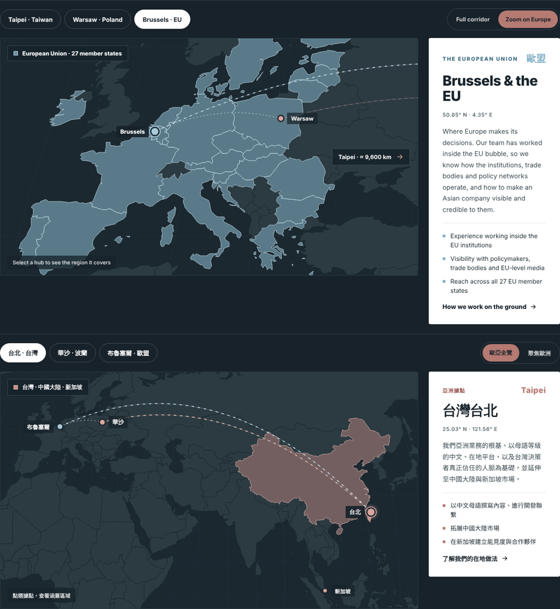

# Polylocal map widget

The interactive corridor map for the polylocal.eu homepage. It shows three hubs and highlights the region each one covers:

| Hub | Region highlighted |
| --- | --- |
| Taipei | Taiwan, Mainland China, Singapore |
| Warsaw | Poland, plus Czechia, Slovakia, Hungary, Romania and the Baltic states |
| Brussels | The 27 EU member states |

It speaks **English** and **Traditional Chinese (Taiwan)** and picks the language by itself, so the same embed works on both versions of the site.



## Add it to the Odoo website

1. Open the page in the website editor and click **Edit**.
2. Drag an **Embed Code** block where the map should go.
3. Replace its content with:

```html
<polylocal-map></polylocal-map>
<script src="https://cdn.jsdelivr.net/gh/antoinesjc/polylocal@2950a8ae90f7fd0ca9fd5b2ea35b520aa189d7e8/map-widget/dist/polylocal-map.js" defer></script>
```

4. Save, then view the published page (Odoo does not run embedded scripts while you are in edit mode, so the block looks empty in the editor). Switch the site to 繁體中文 to check the Chinese version: no second embed is needed.

If Odoo strips the `<script>` tag, put the script line in **Website > Configuration > Settings > Custom Code (head)** instead, and keep only `<polylocal-map></polylocal-map>` in the Embed Code block.

## How the language is chosen

In this order:

1. A `lang` attribute on the widget itself, e.g. `<polylocal-map lang="zh-TW">` forces Chinese.
2. A `/zh_TW/` (or `/zh-TW/`) segment in the page URL, which is how Odoo serves the Chinese site.
3. The page's `<html lang="...">`, which Odoo sets to `zh-TW` on Chinese pages.

Anything starting with `zh` shows Chinese; everything else shows English.

## Options

| Attribute | Values | Default |
| --- | --- | --- |
| `hub` | `taipei`, `warsaw`, `brussels` | `warsaw` |
| `view` | `corridor`, `europe` | `corridor` |
| `theme` | `dark`, `light` | `dark` |
| `lang` | `en`, `zh-TW` | auto |
| `cta-href` | link for "How we work on the ground" (English) | `/about-us` |
| `cta-href-zh` | the same link on the Chinese site | `/zh_TW/about-us` |

Colours can be overridden from the page with CSS variables, e.g.

```css
polylocal-map { --pl-clay: #B57A72; --pl-sky: #81AEC4; --pl-ink: #17222A; }
```

The widget fires `hubchange` and `viewchange` events if you ever want to track clicks in analytics.

## Changing the text

All wording, in both languages, lives in [`src/i18n.js`](src/i18n.js). After editing:

```bash
cd map-widget
npm install      # first time only
npm run build    # writes dist/polylocal-map.js
```

Commit and push the updated `dist/polylocal-map.js`, then point the Odoo embed at the new version. The embed above pins an exact commit (the long code after `@`), so the site always loads exactly that version and CDN caching never serves something stale. To update, either replace that code with the new commit's ID, or create a release on GitHub (Releases > Draft a new release, tag `v1.0.1`) and use `@v1.0.1`.

## Changing the map

Regions, cities and the map framing are set in [`scripts/build-map-data.mjs`](scripts/build-map-data.mjs) (countries use ISO 3166 numeric codes). Run `npm run all` to regenerate the map data and the bundle.

## Preview locally

```bash
cd map-widget
python3 -m http.server 8000
# open http://localhost:8000/demo/
```

The demo page has buttons to switch the page language between English and 繁體中文.

## Files

```
map-widget/
├── dist/polylocal-map.js        the file the website loads (about 80 KB gzipped)
├── src/polylocal-map.js         the widget
├── src/i18n.js                  English and Traditional Chinese text
├── src/map-data.js              generated map shapes (do not edit by hand)
├── scripts/build-map-data.mjs   builds map-data.js from Natural Earth
├── scripts/build.mjs            bundles dist/polylocal-map.js
└── demo/index.html              local preview
```

Map data: [Natural Earth](https://www.naturalearthdata.com/) 1:50m, public domain, via [world-atlas](https://github.com/topojson/world-atlas).
