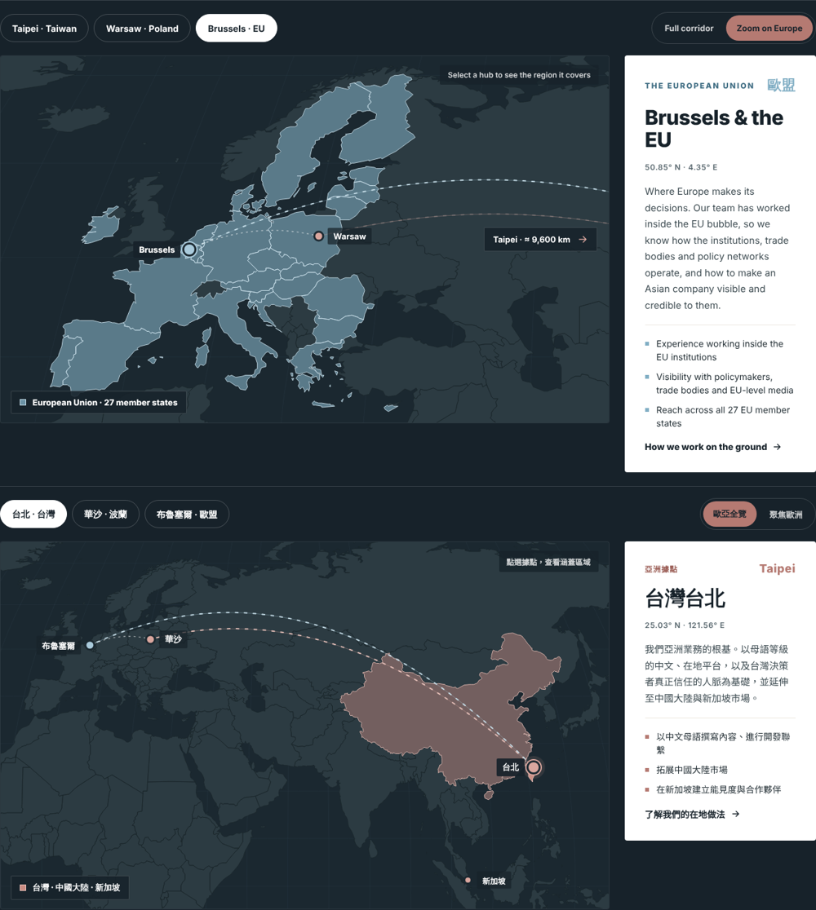

# Polylocal website widgets

Drop-in widgets for the Odoo site at polylocal.eu.

**Every widget is bilingual.** It shows English or Traditional Chinese (Taiwan) and switches by itself to match the language of the page it sits on, so one embed works on both versions of the site. All links inside a widget also point to the matching language (`/about-us` on the English site, `/zh_TW/about-us` on the Chinese site).

| Widget | Script | What it is |
| --- | --- | --- |
| `<polylocal-home>` | `dist/polylocal-home.js` | The whole homepage: hero, map, press and partners, problem, two directions, services, process, team, insights, call to action |
| `<polylocal-map>` | `dist/polylocal-map.js` | The interactive Europe and Asia map on its own (already included in the homepage) |



## Add the homepage in Odoo

1. Open the homepage in the website editor and click **Edit**.
2. Remove the existing blocks between the header and the footer.
3. Drag one **Embed Code** block onto the page.
4. In the block options, set its top and bottom padding to 0.
5. Replace the block's content with:

```html
<polylocal-home></polylocal-home>
<script src="https://cdn.jsdelivr.net/gh/antoinesjc/polylocal@6495009dd11b60d60a9a95ec7440098b2d136d5a/widgets/dist/polylocal-home.js" defer></script>
```

(The code after `@` pins this exact version of the widget.)

6. Save, then open the published page. Odoo does not run embedded scripts in edit mode, so the block looks empty while editing.
7. Switch the site to 繁體中文 to check the Chinese version. No second embed is needed.

The Odoo header, menu, language switcher and footer stay as they are; the widget is everything in between. It stretches itself to the full width of the window even though Odoo places embed blocks inside a centred container. Add the `contained` attribute (`<polylocal-home contained>`) to keep it inside the container instead.

If the published page stays empty, Odoo has removed the `<script>` line. Put that line in **Website > Configuration > Settings > Custom Code (head)** instead, and keep only the `<polylocal-home></polylocal-home>` tag in the block.

### Links the homepage uses

These must exist on the Odoo site (they do today): `/digital-marketing`, `/b2b-lead-generation`, `/about-us`, `/contactus`, `/blog`, `/blog/taiwan-market-trends-15`, `/blog/b2b-14`, `/blog/case-studies-11`. The "Book a free consultation" button goes to `/contactus`, so Odoo's own contact form keeps handling enquiries.

## Add only the map

```html
<polylocal-map></polylocal-map>
<script src="https://cdn.jsdelivr.net/gh/antoinesjc/polylocal@6495009dd11b60d60a9a95ec7440098b2d136d5a/widgets/dist/polylocal-map.js" defer></script>
```

| Map attribute | Values | Default |
| --- | --- | --- |
| `hub` | `taipei`, `warsaw`, `brussels` | `warsaw` |
| `view` | `corridor`, `europe` | `corridor` |
| `theme` | `dark`, `light` | `dark` |
| `cta-href` / `cta-href-zh` | link for "How we work on the ground" | `/about-us` / `/zh_TW/about-us` |

| Hub | Region highlighted |
| --- | --- |
| Taipei | Taiwan, Mainland China, Singapore |
| Warsaw | Poland, plus Czechia, Slovakia, Hungary, Romania and the Baltic states |
| Brussels | The 27 EU member states |

## How the language is chosen

In this order, for every widget:

1. A `lang` attribute on the widget, e.g. `<polylocal-home lang="zh-TW">`, forces a language.
2. A `/zh_TW/` segment in the page address, which is how Odoo serves the Chinese site.
3. The page's `<html lang>`, which Odoo sets to `zh-TW` on Chinese pages.

Anything starting with `zh` shows Chinese; everything else shows English. The logic lives in [`src/shared/lang.js`](src/shared/lang.js).

## Changing text

All wording lives in one file per widget, with English and Chinese side by side:

- Homepage: [`src/home/i18n.js`](src/home/i18n.js)
- Map: [`src/map/i18n.js`](src/map/i18n.js)

Then rebuild:

```bash
cd widgets
npm install      # first time only
npm run build    # writes dist/
```

Commit and push the updated `dist/` files, then change the version code after `@` in the Odoo embed to the new commit. Pinning an exact version means the site always loads exactly that build and the CDN never serves something stale. (A GitHub release tag such as `v1.1.0` works in place of the commit code too.)

## Adding a new widget

1. Create `src/<name>/` with the component, an `i18n.js` holding `en` and `zh-TW` text, and use `detectLang`, `localHref` and `watchLang` from `src/shared/lang.js` so it switches language like the others.
2. Add it to the list in `scripts/build.mjs`.
3. Add a demo page in `demo/`.

## Changing the map

Regions, cities and framing are set in [`scripts/build-map-data.mjs`](scripts/build-map-data.mjs) (countries use ISO 3166 numeric codes). Run `npm run all` to regenerate the map data and rebuild.

## Preview locally

```bash
cd widgets
python3 -m http.server 8000
# homepage: http://localhost:8000/demo/home.html
# map only: http://localhost:8000/demo/map.html
```

Both demo pages have buttons to switch the page language between English and 繁體中文.

## Files

```
widgets/
├── dist/                    the files the website loads
├── assets/logos/            press and partner logos (single-colour)
├── src/shared/lang.js       language detection and links, shared by all widgets
├── src/home/                homepage widget, its text and styles
├── src/map/                 map widget, its text and generated map shapes
├── scripts/                 map data and bundle builders
└── demo/                    local preview pages
```

Map data: [Natural Earth](https://www.naturalearthdata.com/) 1:50m, public domain, via [world-atlas](https://github.com/topojson/world-atlas).
